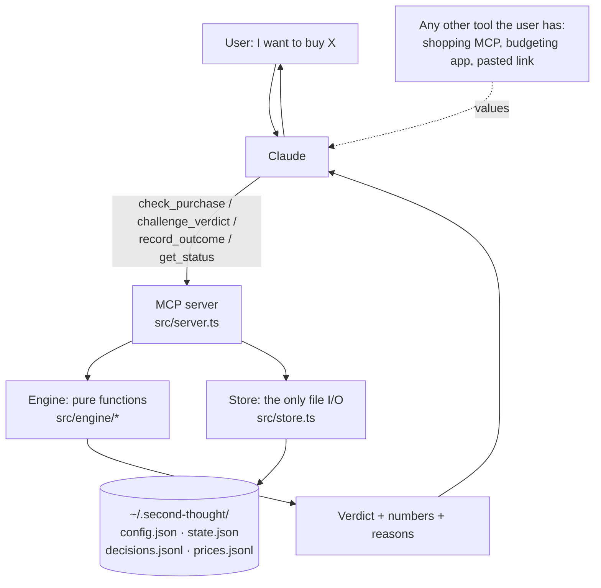

# Second Thought: design

An open-source MCP server that checks a purchase before you make it. It asks fixed multiple-choice questions, computes a verdict (BUY, WAIT or SKIP) with plain arithmetic, and logs every decision and its outcome so you can test later whether it was right. You can argue with it. Arguing changes the verdict only when you change a fact.

Status: design approved 15 Nov 2026. Not built yet.

---

## 1. Goals and non-goals

**Goals**

1. A verdict that is 100% deterministic: the same inputs, history, config and clock always give the same verdict.
2. "Not a yes man" by structure: the verdict moves only when an input changes, never because of repetition, pressure or tone.
3. A need-vs-want label on every check.
4. Every check, challenge, purchase and outcome logged locally, and reviewed at 30 and 90 days.
5. Works for anyone with Claude Desktop or Claude Code and nothing else installed.
6. No network calls, no paid services, no telemetry. Nothing external can break it.

**Non-goals (v1)**

- Blocking a checkout. It gives a verdict and keeps a log. It is not a lock.
- Bank sync, price scraping, price-history APIs.
- A hosted version (claude.ai web and mobile only accept hosted MCPs, and hosting is an external service).
- Any LLM call inside the server.

---

## 2. Approaches considered

| Approach | Verdict deterministic? | Logs and follow-ups | Effort | Decision |
|---|---|---|---|---|
| **A. Skill only** (a SKILL.md prompt) | No. The model computes the verdict, and research shows models give in to pushback | Only if the model remembers to write files | Low | Rejected: fails goal 2 |
| **B. MCP server with a deterministic engine and local files** | Yes | Built in | Medium | **Chosen** |
| **C. Web dashboard** | Possible | Yes | High; needs a running server or browser, sits outside the chat | Not v1. `get_status` covers the report |
| **D. Browser extension** | Possible | Yes | High; one browser at a time, and it is not chat | Not v1 |

B also ships three trigger paths: a manual prompt, a tool description that tells Claude when to call it, and an optional Claude Code hook (see §9).

---

## 3. Architecture



- **The server never talks to other MCPs.** Claude passes values between tools. If a user has a shopping MCP, Claude reads the price there and passes it in. If the user has a budgeting tool, Claude passes in "spent this month". If not, the user types it.
- **The engine is pure.** `decide(input, answers, history, config, now)` returns a verdict. No I/O, no randomness, no network, no clock reads (time is passed in).
- **The store is the only module that touches disk.** Plain files in a data folder outside every repo.

### Modules

| File | Job | Depends on |
|---|---|---|
| `src/engine/questions.ts` | The fixed MCQ bank (data only) | nothing |
| `src/engine/score.ts` | Need score, the 5 components, vetoes, verdict bands, wait period | questions |
| `src/engine/challenge.ts` | Challenge rules (facts vs estimates, repeats) | score |
| `src/engine/stats.ts` | Usage realism, category regret, Brier score, override stats | nothing |
| `src/engine/explain.ts` | Fixed reply templates and "what would change this" | score |
| `src/config.ts` | Defaults, validation, the delayed-loosening rule | engine types |
| `src/store.ts` | Read and write the data folder (atomic writes, append-only logs) | node:fs |
| `src/server.ts` | MCP tools, prompts, server instructions | all of the above |
| `src/index.ts` | Entry point (stdio) | server |

Runtime dependencies: `@modelcontextprotocol/sdk` and `zod`. Nothing else. Node ≥ 18. Tests use the built-in `node:test`.

---

## 4. Data

Data folder: `~/.second-thought/` (override with `SECOND_THOUGHT_HOME`). Users who want a backup can point it at a synced folder.

| File | Contents | Write rule |
|---|---|---|
| `config.json` | Budget, currency, vetoes, weights, thresholds, wait bands | Edited by the user or by `setup`. Changes go through §8.3 |
| `state.json` | The config currently in force, pending config changes and when they started, "spent elsewhere" answers by date, schema version | Atomic: write to a temp file, then rename |
| `decisions.jsonl` | One event per line: `check`, `answers`, `verdict`, `challenge`, `outcome`, `review` | Append only. Never rewritten |
| `prices.jsonl` | `{productKey, price, currency, ts, source}` every time a product is checked | Append only |

Every `verdict` event stores the inputs, the answers, a hash of the config in force, the engine version and the timestamp. Any past verdict can be replayed and must come out the same.

A corrupt line in a `.jsonl` file is skipped with a warning in the tool output. The server never crashes on bad data and never deletes it.

---

## 5. The need test (fixed MCQ bank)

Claude asks these as multiple-choice questions, word for word, with these exact options. Each option has a fixed value.

### 5.1 Need questions

**N1. What's prompting this purchase?**

| Option | Value |
|---|---|
| a. Something I rely on broke, ran out or no longer fits | 1.0 |
| b. A problem I've had again and again for 2+ weeks | 0.7 |
| c. An upgrade: what I have still works | 0.2 |
| d. I saw it (ad, video, friend, deal) and want it | 0.0 |

**N2. Do you already own something that does this job?**

| Option | Value |
|---|---|
| a. No | 1.0 |
| b. Yes, but it's broken or unusable | 0.9 |
| c. Yes, it works but is clearly worse for this job | 0.4 |
| d. Yes, it works fine | 0.0 |

**N3. If you couldn't buy this for 30 days, what would happen?**

| Option | Value |
|---|---|
| a. Real harm: health, safety, income, or a cost that keeps growing | 1.0 |
| b. Things get noticeably harder, but I'd manage | 0.5 |
| c. Nothing much. I'd just keep wanting it | 0.0 |

**N4. Is there a real date you need it by?** (a. Yes: an event, trip or work deadline → asks for the date; b. No. A sale ending doesn't count.) Not scored. A real deadline caps the wait so it ends before the date.

**Need score:**

```
s_need = 0.40·N1 + 0.25·N2 + 0.35·N3        (re-weighted over the questions actually asked)
label  = NEED   if s_need ≥ 0.70
         MIXED  if 0.35 ≤ s_need < 0.70
         WANT   if s_need < 0.35
emergency = (N1 = a) and (N3 = a)
```

Why these weights: the trigger (N1) and the 30-day consequence (N3) are the strongest need signals; owning a substitute (N2) is secondary. The exact numbers are a reasoned guess. Research on fixed linear models shows that consistency matters more than the precise weights (Dawes 1979). They are calibrated later by the outcome data (§10), never mid-argument.

### 5.2 Usage questions

| Q | Question | Kind |
|---|---|---|
| U1 | How many times a month will you use it? | number, estimate |
| U2 | For how many months? (default by category, §6.3) | number, estimate |
| U3 | Anything else you'll need to buy for it (accessories, installation, a subscription)? Total cost | number |

### 5.3 State questions (affect the wait only, never the score)

**S1. When did you first want this?** a. 2+ weeks ago ×1.0 · b. This week ×1.0 · c. Today ×1.5 · d. In the last hour ×2.0

A claimed "2+ weeks ago" earns no credit. Waiting time counts only from the first check in the log (§7.2).

**S2. Right now you're mostly…** a. calm, this was planned ×1.0 · b. bored or scrolling ×1.25 · c. stressed, sad or tired ×1.25 · d. excited, celebrating or just got money ×1.25

The clock: local time 23:00–05:00 ×1.25.

### 5.4 Payment and one-off questions

**P1. How will you pay?**
a. Bank transfer, UPI, debit or cash, in full · b. Credit card, paid in full on the next bill · c. EMI, pay-later or "no-cost EMI" · d. A new card or new credit line · e. My business pays and books it as a business expense

Option e ends the check: "This isn't a personal purchase. Check it against the business budget." It is logged.

**O1. Is this a one-time expense?** yes / no. Feeds the one-off record (§6.4).

**SP. Roughly how much have you spent this month that these checks don't know about?** Asked only when Claude didn't pass `spentThisMonth` and it wasn't answered today. The answer is stored by date in `state.json`.

### 5.5 Question tiers

Asking 11 questions about a ₹300 purchase would make people stop using the tool. The tier depends on price as a share of the monthly budget:

| Tier | Price share | Questions |
|---|---|---|
| Micro | < 2% | N1, P1 |
| Standard | 2–25% | N1, N2, N3, U1, S1, S2, P1, O1 |
| Big | > 25% | all |

Unasked questions use neutral defaults: need is re-weighted over the questions asked, U1 missing → cost per use counts as neutral 0.5, U2 → category default, U3 → 0, S1/S2 → ×1.0, O1 → no.

---

## 6. The maths

All components are in [0, 1]. Money is rounded to 2 decimals, the score to an integer. Notation:

| Symbol | Meaning |
|---|---|
| `P` | price (for a recurring purchase: the amount per period) |
| `A` | add-on cost (U3) |
| `B` | this month's budget (from the budget schedule, otherwise the flat monthly budget) |
| `Sp` | spent this month = passed value, or (checked purchases bought this month + SP answer) |
| `R` | money left this month = `B − Sp` |
| `D` | days in this month |
| `b` | daily budget = `B / D` |
| `T` | total cost of ownership (§6.3) |

### 6.1 Cost this month

```
one-off:          cost = P + A
monthly recurring: cost = P            (plus A if paid now)
yearly recurring:  cost = P + A        (charged now)
```

### 6.2 Budget fit: `s_budget`

```
if R ≤ 0:  s_budget = 0, over-budget veto
share    = cost / R
s_budget = clamp(1 − share, 0, 1)²
```

Squared on purpose: using half of what's left scores 0.25, not 0.5. Spending most of the remaining budget leaves no room for the needs that will come up later in the month.

Budget-days (shown on every verdict, not scored separately): `cost / b`. Example: "This is 4.5 days of your budget." This replaces "hours of work", which is untested and doesn't sting for people with high incomes. Users who set `hourlyIncome` in config see hours as well.

For recurring purchases the verdict also shows the yearly commitment: `12·P` for monthly.

### 6.3 Honest cost per use: `s_cpu`

**Realism factor ρ (overestimated usage).** People who buy gym memberships overestimate how often they'll go, and pay more per visit than the per-visit price (DellaVigna & Malmendier 2006). So the engine discounts claimed uses:

```
ρ_prior = 0.5
after outcomes exist:  ρ_obs = Σ actual uses / Σ predicted uses   (over reviewed purchases)
ρ = (n·ρ_obs + 5·ρ_prior) / (n + 5),   clamped to [0.2, 1.0]
```

`n` = number of reviewed purchases. With no data ρ = 0.5. With many reviews ρ becomes your real ratio. The 5 pulls early estimates towards the prior so two lucky reviews don't swing it.

**Usage fades (hedonic adaptation).** The thrill of a new thing fades (Frederick & Loewenstein 1999), and use usually falls with it. Monthly use is modelled as decaying at rate λ:

```
uses in month t = U1 · ρ · e^(−λ·t)
total effective uses E = U1 · ρ · (1 − e^(−λ·L)) / λ        (λ > 0)
                       = U1 · ρ · L                        (λ = 0)
```

**Category defaults** (all editable in config; λ values are assumptions, evidence: weak):

| Category | Lifespan L (months) | λ per month | Notes |
|---|---|---|---|
| groceries / consumables | 1 | 0 | |
| health / medical | 6 | 0 | |
| work tool | 36 | 0.01 | |
| home / appliance | 60 | 0.01 | |
| electronics / gadget | 36 | 0.08 | use halves in about 9 months |
| clothing / accessories | 24 | 0.06 | |
| hobby / leisure gear | 24 | 0.10 | |
| subscription | 12 | 0.05 | gym-membership effect |
| experience (trip, event, meal) | — | — | cost per use doesn't apply |
| gift | — | — | cost per use doesn't apply |
| other | 12 | 0.05 | |

**Total cost and cost per use:**

```
one-off:    T = P + A + running_cost_per_month·L − resale
recurring:  T = P_monthly·L + A
CPU = T / E
q   = CPU / b                         (each use as a share of one day's budget)
s_cpu = clamp( log10(1/q) / log10(20), 0, 1 )
```

`q = 0.05` (each use costs 5% of a day's budget) scores 1. `q = 1` (each use costs a whole day's budget) scores 0. The log scale treats "twice as expensive per use" the same at any price. Because the scale is relative to the user's own budget, it works in any currency.

Experiences and gifts: `s_cpu = 0.5` (neutral). Cost per use is meaningless for them, and research suggests experiences keep their value better than things (Van Boven & Gilovich 2003). Budget fit carries the weight instead.

Resale value and running costs are optional inputs, default 0.

### 6.4 Your track record: `s_history`

**Category regret** (outside view: use your own past results for similar purchases, Kahneman & Lovallo 1993):

```
regret per reviewed purchase = 1 if "worth it" = no, 0.5 if "meh", 0 if "yes"
r_c = (Σ regret in category + 5·0.3) / (n_c + 5)        (prior: 30% regret)
```

**One-off pressure.** People spend almost twice what they predict on "exceptional" purchases because each one feels unique. Tracking them as one group fixes this (Sussman & Alter 2012). If O1 = yes:

```
c90 = number of purchases marked one-off in the last 90 days
p   = min(c90 / 5, 1) · 0.5
```

```
s_history = (1 − r_c) · (1 − p)              (no data: 0.7)
```

The verdict shows the record in plain words: "This is your 4th one-time purchase in 90 days. Together: $X."

### 6.5 Real discount: `s_deal`

The price history comes only from `prices.jsonl`, i.e. prices the user saw while checking. MRP, list price, "x% off" and stock warnings are never inputs.

```
known if ≥ 3 observations of this productKey spanning ≥ 7 days within the last 90 days
M = median of those prices
d = (M − P) / M
s_deal = clamp(0.5 + d / 0.4, 0, 1)        known
       = 0.5                                unknown (neutral)
```

20% under its usual price scores 1. At its usual price, 0.5. 20% above, 0. Deals carry only 5% weight (±2.5 points at most). A deal on a want is still a want.

If Claude passes `sellerClaims` (e.g. "only 2 left", "60% off"), they are logged and shown as "ignored: anchoring / false urgency". They have no effect on the score.

### 6.6 Opportunity cost (shown, not scored)

Reminding people what else the money could do lowers purchase rates (Frederick et al. 2009). Every verdict shows what the money would grow to in today's money:

```
r_real = config.realReturn                  (default 0.04 = 4% above inflation)
FV_n   = cost · (1 + r_real)^n,   n = 10 and 20 years
recurring, monthly P:  FV = P · ((1+i)^(12n) − 1) / i,   i = (1 + r_real)^(1/12) − 1
```

It is not scored because price already counts in budget fit and cost per use. Scoring it again would double-count.

### 6.7 Monthly equivalent (shown, not scored)

```
one-off:  T / L per month
monthly:  P per month, 12·P per year
```

This cuts both ways: "$499 a month is nothing" becomes "$5,988 a year". A durable item that lasts 5 years gets a fair hearing too.

### 6.8 The score

```
S = round( 100 · ( 0.40·s_need + 0.25·s_budget + 0.20·s_cpu + 0.10·s_history + 0.05·s_deal ) )
```

Need carries the most weight because the question is "should you buy this at all", not "is this a good price".

### 6.9 Vetoes (applied after the score, in this order)

| # | Veto | Effect | Emergency bypass? |
|---|---|---|---|
| 1 | Blocked category (config: `{category, until}`) | SKIP until the date | yes |
| 2 | Debt: P1 = c (EMI/pay-later) or d (new credit), if enabled (default on) | That payment method is never allowed. The verdict is computed as if paid in full, and labelled "only if paid in full" | no |
| 3 | Credit card policy: `allow`, `block` or `{onlyMerchants: [...]}` | Same as #2 for card use the policy doesn't allow | no |
| 4 | Over budget: `cost > R` | Can't be BUY this month → WAIT until next month (if S ≥ 50), otherwise SKIP | yes |
| 5 | One-off cap (only if `oneOffs.mode = "cap"`; the default mode `count` treats one-offs like any other spending against the monthly budget) | Cap used up → WAIT until it resets, or SKIP | yes |

**Emergency** (N1 = a and N3 = a: it broke, and waiting does real harm) → BUY now, wait 0. The verdict adds "buy the cheapest option that fixes the harm" and is logged as an emergency, so you can see if emergencies keep happening.

### 6.10 Verdict bands

| Score | Verdict |
|---|---|
| ≥ 70 | **BUY** once the wait is over. Until then: WAIT with an exact re-check date |
| 50–69 | **WAIT** for 2× the wait (at least 24 h). At the re-check, if the score is still ≥ 50 and you still want it → BUY, marked "marginal" |
| < 50 | **SKIP** |

Wanting something for the whole wait is evidence in itself: the urge outlived the hot moment (Hoch & Loewenstein 1991). Waiting never turns a SKIP into a BUY.

### 6.11 The wait

```
share_of_month = cost / B
base = 0 h     if share < 2%
       24 h    if 2–5%
       7 d     if 5–25%
       30 d    if 25–100%
       60 d    if > 100%
multiplier = S1 × S2 × clock,   capped at 2.0
W = base × multiplier            (rounded up to the hour)
replacement (N1 = a):  W = min(base, 24 h), no multiplier
emergency:             W = 0
real deadline (N4):    W ends at least 1 day before the date
```

The bands are rules of thumb (evidence: weak). Delay as a self-control tool is well supported (Hoch & Loewenstein 1991). Exact lengths are not. They are config values.

### 6.12 Worked example (a made-up person, not real data)

Flexible budget $2,000 a month, 30-day month, day 10, spent $900 → R = $1,100, b = $66.67/day. Wireless headphones, $300, electronics. Answers: N1 = c (upgrade), N2 = d (current pair works fine), N3 = c (nothing happens), U1 = 20 uses a month, S1 = c (today), S2 = a (calm), 14:00, P1 = a.

| Step | Working | Result |
|---|---|---|
| s_need | 0.40·0.2 + 0.25·0 + 0.35·0 | 0.08 → **WANT** |
| s_budget | (1 − 300/1100)² = 0.7273² | 0.529 |
| E | 20 · 0.5 · (1 − e^(−0.08·36)) / 0.08 = 10 · 11.80 | 118 uses |
| CPU, q | 300 / 118 = $2.54; 2.54 / 66.67 | q = 0.038 |
| s_cpu | log10(1/0.038) / log10(20) = 1.09 → clamp | 1.0 |
| s_history | no data | 0.7 |
| s_deal | no price history | 0.5 |
| S | 100·(0.032 + 0.132 + 0.200 + 0.070 + 0.025) | **46 → SKIP** |
| Shown | 4.5 budget-days · $2.54 per use · $444 in 10 years, $657 in 20 · $8.33/month over 3 years | |

**What would change this** (computed, §7.4): "If your current pair broke (N1 = a, N2 = b) and going without would make things harder (N3 = b), the score would be 75: BUY after 24 hours."

**Challenge:** "I'll use them 60 times a month, not 20." U1 is an estimate revised after the verdict, so it counts at 50%: 20 + 0.5·(60 − 20) = 40. Cost per use already scores 1.0, so the score stays 46. The verdict stands. The reply says why: the problem is need, not cost per use.

---

## 7. Arguing with it

### 7.1 Challenges must name a field

`challenge_verdict(decisionId, field, newValue, note?, argumentType?)`

| Field type | Fields | Rule |
|---|---|---|
| **Facts** | price, add-on cost, N1, N2, N3, N4 date, spent this month, payment method | Count in full. Logged with your one-line note. If the verdict flips, the status page marks it "changed after verdict" |
| **Estimates** | U1 uses a month, U2 months | After a verdict: each can be revised **once**, and the revision counts at **50%**: `effective = original + 0.5·(new − original)` |
| **Nothing** | field = `none` | The verdict stands. The argument is logged |

Why estimates are discounted: an estimate made after seeing an unwelcome verdict is shaped by wanting a different answer (motivated reasoning, Kunda 1990). Facts about the world don't have that problem, so they count in full.

### 7.2 Things that can't move the verdict

- **Repetition.** The same field with the same value is a no-op, logged as "repeat".
- **Claimed time.** Waiting counts from the first check of that product in the log, not from "I've wanted it for ages".
- **Pressure arguments.** `argumentType` is a fixed list. Each type gets a fixed reply and no score change:

| argumentType | What it sounds like | Fixed reply is based on |
|---|---|---|
| `deserve` | "I've been good, I earned it" | Licensing effect (Khan & Dhar 2006; Kivetz & Simonson 2002) |
| `scarcity` | "Only 2 left", "deal ends tonight" | Scarcity (Worchel et al. 1975); fake timers are common (Mathur et al. 2019); false urgency is a banned dark pattern in India (CCPA 2023) |
| `sale` | "It's 60% off" | Anchoring (Tversky & Kahneman 1974). Only your own price history counts (§6.5) |
| `one_time` | "It's a one-time expense" | Sussman & Alter 2012, plus your one-off record (§6.4) |
| `social` | "Everyone has one" | Social proof (Cialdini 1984) |
| `mood` | "I had a terrible day" | Shopping does lift a sad mood (Rick et al. 2014). The feeling is real, but it isn't a fact about this purchase |
| `sunk` | "I've spent hours researching it" | Sunk cost (Arkes & Blumer 1985) |
| `future_use` | "I'll use it loads" | Not a pressure type: it is redirected to the U1 estimate rule |
| `other` | anything else | "Which fact changed?", with the list of fields |

### 7.3 Overrides

You can always buy anyway. `record_outcome(bought: true)` on a non-BUY verdict logs an override. No extra friction. A tool that feels controlling gets rejected or uninstalled (psychological reactance, Brehm 1966), so the override stays one call away and is stated plainly in every verdict.

### 7.4 "What would change this"

For every verdict the engine tries each alternative answer of each fact question, one at a time, and reports the smallest set of fact changes that would move the verdict up a band. Fully deterministic. This tells the user exactly how to win the argument legitimately: with facts (counterfactual explanations, Wachter et al. 2017).

---

## 8. Rules for Claude, and for the config

### 8.1 Server instructions (sent to Claude by the MCP)

1. When the user wants to buy something, or is comparing or price-checking with intent to buy, call `check_purchase` before helping them buy.
2. Ask the returned questions as multiple choice, word for word, with the given options.
3. Never give your own verdict. Relay the engine's verdict and its reasons.
4. If the user pushes back, ask which fact changed and call `challenge_verdict`. If nothing changed, the verdict stands: say so and give the fixed reason.
5. If a tool response lists reviews due, offer to run them.

This is the soft layer. The hard layer is §7: even if Claude ignores the instructions, it can't change a verdict without changing an input, and every change is logged.

### 8.2 Every verdict message, in this order

1. Verdict and need label in one line ("WAIT 7 days: this is a WANT").
2. The numbers: budget-days, cost per use, opportunity cost (10 and 20 years), monthly equivalent, wait end date and time.
3. The top two reasons (largest score contributions or vetoes).
4. What would change this (§7.4).
5. "If you still want it on {date}, check again" (if-then plans increase follow-through, Gollwitzer 1999).
6. "You can still buy it. It will be logged as an override."

Fixed templates. No moralising, no shaming words.

### 8.3 Pre-commitment: loosening the rules takes 7 days

The config is a contract you sign while calm (Ariely & Wertenbroch 2002; Bryan, Karlan & Nelson 2010). People overrate their future self-control (Nordgren et al. 2009), and someone mid-craving will happily raise their own budget.

| Change | Takes effect |
|---|---|
| Budget down, veto on, category blocked or blocked for longer, wait bands longer, buy/wait thresholds higher | Immediately |
| Everything else (budget up, veto off, unblock, shorter waits, lower thresholds, any weight change) | After `loosenDelayDays` (default 7), counted from when the change was first seen |
| First-time setup | Immediately |

Implementation: on each call the store compares `config.json` with the config in force in `state.json`. Tightening changes apply at once. Loosening changes go into `pending` with a timestamp and apply when the delay has passed. `get_status` shows pending changes and when they apply.

---

## 9. MCP surface

### 9.1 Tools

| Tool | Input | Output |
|---|---|---|
| `setup` | currency, monthly budget (or month-by-month schedule), credit card policy, optional hourly income | Config written. With no input: shows the current config |
| `check_purchase` | item, price, category, recurring (none/monthly/yearly), productKey or URL (optional), spentThisMonth (optional), sellerClaims (optional), answers (optional) | Either `{status: "questions", questions[]}` or `{status: "verdict", decisionId, verdict, needLabel, score, breakdown, numbers, reasons, whatWouldChange, waitUntil, vetoes}` |
| `challenge_verdict` | decisionId, field, newValue, note, argumentType | New verdict and what moved, or "stands" with the fixed reason |
| `record_outcome` | decisionId, event (`bought`, `not_bought`, `review`), review answers | Logged. Overrides are marked |
| `get_status` | — | Money left this month, waits ending, reviews due, pending config changes, accuracy (§10) |

Every tool response carries `reviewsDue: n`. The server can't send notifications, so reviews come up the next time the user talks about buying anything.

### 9.2 Prompts

- `should-i-buy` (args: item, price): manual trigger. A slash command in Claude Code, a menu item in Claude Desktop.
- `review`: runs the reviews that are due.

### 9.3 Triggers

| Trigger | Where | Reliability |
|---|---|---|
| `should-i-buy` prompt | Claude Code, Claude Desktop | Always, manual |
| Tool description + server instructions | Every MCP client | Usually; Claude decides |
| Hook on shopping tool calls (README snippet) | Claude Code, opt-in | Guaranteed |

### 9.4 Errors

| Case | Behaviour |
|---|---|
| No config | Every tool returns the setup questions |
| Invalid input | zod error naming the field |
| No spent-this-month value | Uses the log + the SP question |
| Corrupt log line | Skipped, warning in the output, file never rewritten |
| Data folder not writable | Clear error. No verdict without a log (the log is the point) |

---

## 10. Is the engine right? (outcomes and calibration)

### 10.1 Reviews

| When | For | Questions |
|---|---|---|
| +30 and +90 days | bought items | How many times have you used it? (number) · Worth it? (yes / meh / no) |
| +30 days | WAIT/SKIP not bought | Do you miss not having it? (yes / no / bought something else instead) |

### 10.2 What `get_status` reports

| Metric | Formula | Shown after |
|---|---|---|
| Brier score | mean of (S/100 − o)² over bought items; o = 1 yes, 0.5 meh, 0 no (Brier 1950) | 10 reviews |
| Brier skill score | 1 − Brier / Brier of always predicting your base rate. Above 0 = better than a constant guess | 10 reviews |
| Followed vs override | "worth it" rate when you followed BUY vs when you overrode | 5 each |
| False-skip rate | share of WAIT/SKIP where you still miss it at 30 days | 5 |
| Usage realism ρ | §6.3 | 1 review |
| Money not spent | sum of prices for WAIT/SKIP not bought | always |

### 10.3 What learns, and what never does

- **Learns automatically:** ρ, category regret, the one-off record. These are your own data, used the same way every time.
- **Never changes automatically:** weights, thresholds, wait bands, vetoes.
- **Suggestions only:** if overrides are judged "worth it" ≥ 70% of the time over ≥ 10 overrides, or the false-skip rate is > 30% over ≥ 10, `get_status` suggests loosening, and says which number. Applying it goes through the 7-day rule (§8.3).

---

## 11. Determinism guarantees

1. Engine = pure function of (inputs, answers, history, config, now).
2. No randomness. No network. No LLM.
3. Every verdict stores the config hash and engine version. A replay test re-runs every stored fixture and must get the same verdict.
4. A test reads the imports of every source file and fails if anything outside `node:fs`, `node:path`, `node:os`, `node:crypto`, the MCP SDK or zod is imported. No `fetch`, `http`, `net`.
5. Fixed rounding: money to 2 decimals, score to an integer, wait rounded up to the hour.

---

## 12. Testing

- **Formulas:** one test per formula in §6 with hand-worked numbers (the §6.12 example is a test).
- **Golden scenarios** (made-up people, never real data): emergency replacement · late-night gadget impulse · subscription · experience · fourth one-off in 90 days · fake discount · EMI veto · over budget · wait served and still wanted · estimate-inflation challenge · repeated challenge.
- **Monotonic checks:** a higher price never raises the score; owning a better substitute never raises need; a longer wait history never lengthens the wait.
- **Determinism:** replay test and import test (§11).
- **Config:** loosening waits 7 days; tightening is immediate.
- **MCP smoke test:** an in-process SDK client calls each tool over stdio.

All on `node:test`. No test framework dependency.

---

## 13. Privacy

- The repo holds only code, generic defaults, synthetic test data and docs.
- Personal data lives only in the data folder, outside every repo. Nothing is ever sent anywhere.
- Integrations with other tools are instructions to Claude (pass a value in), not code. The repo names no specific budgeting app or bank.
- Before the repo goes public: scan the full git history for personal strings with a denylist kept outside the repo.

---

## 14. Build plan

| Step | Contents | Check before moving on |
|---|---|---|
| 0 | Private GitHub repo `second-thought-mcp`, MIT, `main` only. First commit: README stub, LICENSE, this design as `docs/DESIGN.md` | Repo exists, private |
| 1 | PR 1, engine: questions, score, wait, challenge, explain, stats + tests | All formula, golden, monotonic and determinism tests pass |
| 2 | PR 2, store and config: data folder, atomic writes, delayed loosening + tests | Store tests pass; replay works from files |
| 3 | PR 3, MCP server: tools, prompts, instructions + smoke test | Smoke test passes; manual run in Claude Code |
| 4 | Local install, personal config (outside the repo), optional hook | Real checks for 2–4 weeks |
| 5 | Public: README, history scan, flip to public, npm, MCP Registry | Each step only with the owner's OK |

---

## 15. Research basis

| Source | Used for | Evidence |
|---|---|---|
| Dawes 1979, *Am. Psychologist*; Grove et al. 2000, *Psych. Assessment* (136 studies) | Fixed formula instead of judgment | Strong |
| DellaVigna & Malmendier 2006, *AER* | Realism factor ρ | Strong |
| Sussman & Alter 2012, *JCR* | One-off record | Strong |
| Frederick et al. 2009, *JCR* | Showing opportunity cost | Strong |
| Prelec & Loewenstein 1998, *Marketing Sci.*; Prelec & Simester 2001, *Marketing Letters* | Pain of paying; credit card policy | Strong (the size of the card effect varies) |
| Ariely & Wertenbroch 2002, *Psych. Sci.*; Bryan, Karlan & Nelson 2010, *Ann. Rev. Econ.* | Pre-commitment; 7-day loosening | Strong |
| Hoch & Loewenstein 1991, *JCR*; Loewenstein 2005, *Health Psych.*; Nordgren et al. 2009, *Psych. Sci.* | Waiting; hot–cold gap; restraint bias | Strong (that delay helps) / weak (the exact lengths) |
| Kunda 1990, *Psych. Bull.* | 50% weight on revised estimates | Strong |
| Khan & Dhar 2006, *JMR*; Kivetz & Simonson 2002, *JMR* | `deserve` reply | Strong |
| Tversky & Kahneman 1974, *Science*; Ariely, Loewenstein & Prelec 2003, *QJE* | Ignoring MRP | Strong |
| Worchel et al. 1975, *JPSP*; Mathur et al. 2019, *CSCW*; CCPA Dark Patterns Guidelines 2023 | `scarcity` reply | Strong |
| Kahneman & Lovallo 1993, *Mgmt. Sci.* | Category regret (outside view) | Strong |
| Brehm 1966 | Override always available, no shaming | Strong |
| Gollwitzer 1999, *Am. Psychologist* | Re-check date as an if-then plan | Strong |
| Brier 1950, *Monthly Weather Review* | Accuracy score | Standard method |
| Frederick & Loewenstein 1999; Van Boven & Gilovich 2003, *JPSP* | Usage decay λ; experiences neutral on cost per use | Medium (λ values are assumptions) |
| Wachter, Mittelstadt & Russell 2017, *Harvard JOLT* | "What would change this" | Method |
| Arkes & Blumer 1985; Cialdini 1984; Rick et al. 2014, *JCP* | `sunk`, `social`, `mood` replies | Strong / strong / medium |
| Hagger et al. 2016, *Persp. Psych. Sci.* (23-lab ego-depletion replication failed) | Why mood and late-night only nudge the wait | Shows a popular theory failed |
| Conlon & Schwardmann 2026, CESifo WP 12681; Zhao et al., arXiv 2604.24668; SPINE 2026 | Why the LLM never computes the verdict | Strong for "models give in" |
